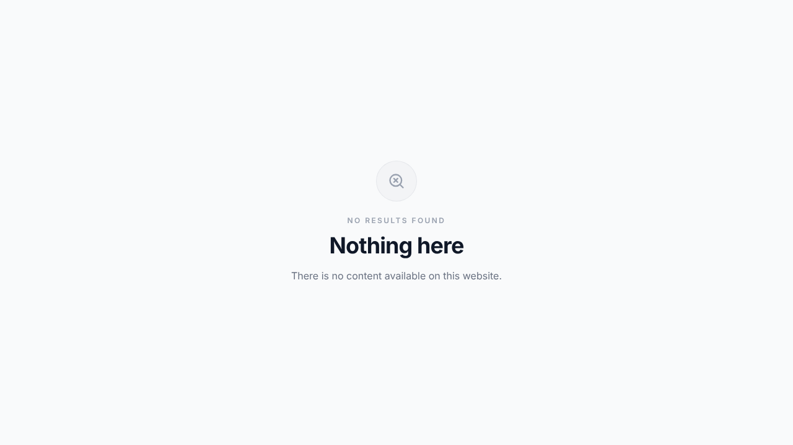

# Public Site Shutdown: Change Record

| | |
|---|---|
| **Date** | 2 Nov 2026 |
| **Branch** | `claude/peaceful-gates-ndrvhl` |
| **Change type** | Routing, access control, search-engine visibility and site icon. No code was removed. |
| **Affected audience** | Public visitors and search engines |
| **Staff / Admin impact** | None. All features work as before. |
| **Reversible** | Yes. Change two constants and restore one image file (see [§9](#9-how-to-re-enable)). |

---

## 1. Summary

The client-facing results website (live Morning/Night results, Jodi Chart, Panel Chart and Disclaimer) has been **taken offline**. Anyone who opens the public site now sees a neutral **"Nothing here / No results found"** page. Results are no longer available to anonymous visitors through the API either.

The **whole website is also being removed from search engines.** Every page sends `<meta name="robots" content="noindex, nofollow">`, and every response (pages, images, static files, API) sends the `X-Robots-Tag: noindex, nofollow` header.

The **default Vercel/Next.js site icon (favicon) has been removed**, and the site now declares an empty icon, so no icon is shown in the browser tab.

The **Staff portal** (`/staff/...`) and the **Admin portal** (`/admin/...`) are unchanged and remain fully operational for internal use.

**No existing line of code was deleted or modified.** The public site's code is still in the repository. It is no longer routed. Every change to an existing code file only adds lines (`git diff 8726496`, the last commit before this change, shows **58 insertions, 0 deletions** across existing code files). The only file removed is the default favicon image (`src/app/favicon.ico`), which was removed on request. It is an image, not code.

---

## 2. Objectives and constraints

| Requirement | How it was met |
|---|---|
| Shut down everything that shows results to the public | `/` is rewritten to a "Nothing here" page, and `GET /api/results` now requires a signed-in staff/admin account. |
| Visitors should see that there is nothing on the website | New neutral notice page with no branding, no links and no results. |
| Remove the website completely from search engines | `noindex, nofollow` robots meta tag on every page, plus an `X-Robots-Tag` header on every response (see [§4](#4-search-engine-removal)). |
| Do not delete a single line of code | Only additive edits. The public page (`src/app/page.tsx`, 514 lines) and the results components are untouched. |
| Do not change any Staff/Admin feature | Staff/admin routes, pages, APIs and auth flow are untouched. They were verified after the change (see [§10](#10-verification-performed)). |
| Professional and reversible | Two feature flags in one file, `src/config/public-site.ts`. Turning things back on means changing those values. |

---

## 3. What a visitor sees now



- Title in the browser tab: **"Nothing here"**
- Message: **"No results found / Nothing here / There is no content available on this website."**
- Follows the visitor's light/dark system preference and works on mobile.
- No logo, no navigation and no links to the staff/admin login pages, so the internal portals are not advertised.

### 3.1 Site icon (favicon)

The default Vercel/Next.js favicon that came with the project template (`src/app/favicon.ico`) has been **removed**. No icon is shown anywhere on the website, including the public notice, staff, admin and 404 pages.

- Every page now declares an **empty icon** (`<link rel="icon" href="data:,">`, set in the root layout metadata). This has two effects:
  - browsers do not fall back to requesting `/favicon.ico`, so there is no extra request and no 404;
  - returning visitors who still have the old Vercel icon in their browser cache get it replaced by the empty icon.
- `/favicon.ico` now returns **404**.
- The browser tab shows its built-in blank page icon, so the site has no branding at all.

---

## 4. Search-engine removal

### 4.1 What was added

| Layer | Where | What it does | Covers |
|---|---|---|---|
| Robots meta tag | `src/app/layout.tsx` (root metadata) | Renders `<meta name="robots" content="noindex, nofollow">` in the `<head>` | **Every HTML page**: notice, staff login and dashboards, admin login and dashboards, 404 page |
| `X-Robots-Tag` HTTP header | `next.config.ts` (`headers()`, source `/:path*`) | Sends `X-Robots-Tag: noindex, nofollow` | **Every response**, including those that cannot hold a meta tag: images (`/logo-1.png`, `/background-*.webp`), JS/CSS, API JSON, redirects |

Both layers are controlled by `SEARCH_ENGINE_INDEXING_ENABLED = false` in `src/config/public-site.ts`.

- **`noindex`** tells search engines to drop the page and its images from their results.
- **`nofollow`** tells them not to follow links from the page.

### 4.2 Why there is no `robots.txt` "Disallow: /"

This was left out on purpose. A search engine only learns about `noindex` when it **crawls** a page. If `robots.txt` blocked crawling, Google could not see the `noindex`, and the old pages could stay in results as "Indexed, though blocked by robots.txt". The site currently has no `robots.txt` (it returns 404), and crawlers treat that as "crawling allowed", which is what de-indexing needs. A `Disallow: /` can optionally be added **after** `site:banaras.life` returns no results.

### 4.3 Timeline and how to speed it up (manual, owner action)

`noindex` takes effect as each URL is re-crawled. That usually takes **a few days to a few weeks**. To hide the site from Google quickly:

1. **Google Search Console** → add and verify `banaras.life` (a Domain property, verified by a DNS TXT record).
2. **Indexing → Removals → New request → Temporarily remove URL** → choose **"Remove all URLs with this prefix"** → enter `https://banaras.life/` → **Submit**. This usually hides the site from Google within about a day, for roughly 6 months. During that time the `noindex` makes the removal permanent.
3. *(Optional)* **URL Inspection** → enter `https://banaras.life/` → **Request indexing**. This makes Google re-crawl sooner and see the `noindex`.
4. **Bing Webmaster Tools** (Bing results also feed Yahoo and DuckDuckGo): add the site and use **Block URLs** for the whole site.
5. Check progress by searching `site:banaras.life` on Google and Bing.

---

## 5. Behaviour before vs. after

| Request | Before | After |
|---|---|---|
| `GET /` (public homepage, all tabs) | Live results, Jodi/Panel charts, disclaimer | **"Nothing here" notice** (200) |
| `GET /?anything` | Public results app | **"Nothing here" notice** |
| Client-side navigation to `/` (e.g. "Go to Homepage" on the 404 page) | Public results app | **"Nothing here" notice.** No result or Supabase calls are made. |
| `GET /site-unavailable` | n/a (did not exist) | "Nothing here" notice |
| `GET /api/results` (anonymous) | **Full results history (public)** | **401 Unauthorized** |
| `GET /api/results` (signed-in, active staff/admin) | Results | Results (**unchanged**) |
| `GET /api/results` (signed-in but deactivated account) | Results | 403 Access denied |
| Unknown paths, e.g. `/xyz` | 404 page | 404 page (unchanged) |
| `/admin` (not signed in as admin) | 404 page (hidden) | 404 page (unchanged) |
| `/admin/JaiGjmmjmcjmbjmk0021` (admin login) | Login page | Login page (unchanged) |
| `/staff` (not signed in) | Redirect to `/staff/login` | Redirect to `/staff/login` (unchanged) |
| `/staff/...` and `/admin/...` (signed in) | Dashboards | Dashboards (unchanged) |
| All other `/api/...` endpoints | Auth-protected | Unchanged |
| **Search-engine indexing (any URL)** | Allowed (no robots directives) | **`noindex, nofollow`** (meta tag + header) |
| **Browser tab icon (all pages)** | Default Vercel/Next.js favicon | **None** (empty icon) |
| `GET /favicon.ico` | Vercel/Next.js favicon | **404** |

---

## 6. Files changed

### 6.1 New files

| File | Purpose |
|---|---|
| `src/config/public-site.ts` | Single source of truth. `PUBLIC_SITE_ENABLED = false` turns off the public site. `SEARCH_ENGINE_INDEXING_ENABLED = false` turns off search-engine indexing. It also holds the list of public paths (`['/']`) and the notice route (`/site-unavailable`). |
| `src/utils/public-site/middleware.ts` | `handlePublicSiteAccess()`: while the public site is disabled, it rewrites public paths to the notice route and adds the `X-Robots-Tag` header. Returns `null` for every other path so the existing middleware runs unchanged. |
| `src/app/site-unavailable/page.tsx` | The "Nothing here" notice page. It is a static server component with `noindex` metadata, and it overrides the public title, description and keywords. |
| `docs/PUBLIC_SITE_SHUTDOWN.md` | This document. |
| `docs/assets/site-unavailable.png` | Screenshot of the notice used in this document. |

### 6.1a Removed file (on request)

| File | Reason |
|---|---|
| `src/app/favicon.ico` | The default Vercel/Next.js site icon from the project template (25,931-byte binary image, not code). It was removed so the site shows no icon. It can be restored from git history (see [§9](#9-how-to-re-enable)). |

### 6.2 Existing files (lines added only, none removed)

| File | Lines | Change |
|---|---|---|
| `src/middleware.ts` | +8 | Runs the public-site check before the existing Supabase session handling |
| `src/app/api/results/route.ts` | +22 | Auth guard at the top of `GET` |
| `src/app/layout.tsx` | +12 | `robots` entry (site-wide `noindex, nofollow` meta tag) and an empty `icons` entry (no site icon) in the root metadata |
| `next.config.ts` | +16 | `headers()` sending `X-Robots-Tag` on every response |

**`src/middleware.ts`**

The original `return await updateSession(request)` line is still there, unchanged.

```ts
import { handlePublicSiteAccess } from '@/utils/public-site/middleware'

export async function middleware(request: NextRequest) {
    // Public results site is shut down: its paths now show the "Nothing here" notice.
    // Staff/Admin routes are untouched. See src/config/public-site.ts
    const publicSiteResponse = handlePublicSiteAccess(request)
    if (publicSiteResponse) {
        return publicSiteResponse
    }

    return await updateSession(request)   // ← original line, unchanged
}
```

**`src/app/api/results/route.ts`** (`GET` handler only)

The guard uses the same pattern as the other protected API routes (`createClient()` → `auth.getUser()` → `profiles` lookup), so results are only returned to a signed-in **active** staff/admin account. The rest of `GET` and the whole `POST` handler (declare result) are unchanged.

```ts
if (!PUBLIC_SITE_ENABLED) {
    const authClient = await createClient()
    const { data: { user } } = await authClient.auth.getUser()
    if (!user) return NextResponse.json({ error: 'Unauthorized' }, { status: 401 })

    const { data: profile } = await authClient.from('profiles').select('is_active').eq('id', user.id).single()
    if (!profile || !profile.is_active) return NextResponse.json({ error: 'Access denied' }, { status: 403 })
}
```

> The "active account" rule matches what `src/utils/supabase/middleware.ts` already enforces for `/staff` pages. A deactivated user could not reach the staff dashboard before this change either.

**`src/app/layout.tsx`** (existing `title`, `description` and `keywords` unchanged)

```ts
import { SEARCH_ENGINE_INDEXING_ENABLED } from "@/config/public-site";

export const metadata: Metadata = {
  // ...existing title / description / keywords...
  robots: {
    index: SEARCH_ENGINE_INDEXING_ENABLED,
    follow: SEARCH_ENGINE_INDEXING_ENABLED,
  },
  // No site icon. The default Vercel/Next.js favicon was removed; this empty icon
  // stops browsers from requesting /favicon.ico and replaces any cached copy of it.
  icons: {
    icon: "data:,",
  },
};
```

**`next.config.ts`** (existing `/* config options here */` comment kept)

```ts
import { SEARCH_ENGINE_INDEXING_ENABLED } from "./src/config/public-site";

const nextConfig: NextConfig = {
  /* config options here */
  async headers() {
    if (SEARCH_ENGINE_INDEXING_ENABLED) {
      return [];
    }
    return [{ source: "/:path*", headers: [{ key: "X-Robots-Tag", value: "noindex, nofollow" }] }];
  },
};
```

---

## 7. Code intentionally kept (not deleted, now unrouted or unused by the public)

| File | Status |
|---|---|
| `src/app/page.tsx` (514 lines) | The complete public results app. **Byte-for-byte unchanged.** It is still compiled, but no request can reach it while the flag is off. |
| `src/components/results/*` (`CurrentResult`, `JodiChart`, `PanelChart`, `GameTimeline`, `ResultHistory`) | Unchanged. `CurrentResult`, `JodiChart` and `PanelChart` are still used by the Staff dashboard and Staff charts. |
| `src/app/globals.css` (public-site styles) | Unchanged. |
| `src/app/not-found.tsx` | Unchanged. This page is deliberately left alone: the middleware also shows it to anyone who is not an admin and opens `/admin`. If unknown paths showed the notice while `/admin` showed the 404 page, outsiders could tell that `/admin` exists. It now also inherits the site-wide `noindex` tag. |
| `src/lib/results.ts` | Unchanged (it was not used by any route before this change either). |
| Supabase schema, migrations, RLS policies, cron jobs | Unchanged. See [§11](#11-recommended-follow-ups-not-applied) for optional hardening. |

---

## 8. How it works

```
Request ──► next.config.ts headers()                       (new)
              └─ every response: X-Robots-Tag: noindex, nofollow

        ──► src/middleware.ts
              │
              ├─ handlePublicSiteAccess(request)          (new)
              │     PUBLIC_SITE_ENABLED === false  AND  path ∈ PUBLIC_SITE_PATHS ('/')
              │        └─► rewrite to /site-unavailable
              │
              └─ updateSession(request)                    (existing, unchanged)
                    ├─ /staff/**  → requires active profile, else redirect /staff/login
                    ├─ /admin/**  → requires active admin, else 404
                    └─ everything else → pass through

Every HTML page ──► root layout metadata: <meta name="robots" content="noindex, nofollow">   (new)

GET /api/results ──► guard (new): signed-in + active profile required ──► existing query logic
```

The URL in the visitor's address bar stays `/`. The response is the notice page, so no old URL leaks or redirects anywhere.

---

## 9. How to re-enable

Both switches are in `src/config/public-site.ts`. They are independent: bringing the public site back does **not** make the website indexable again by itself.

| Goal | Change | Then |
|---|---|---|
| Bring back the public results site | `PUBLIC_SITE_ENABLED = true` | Build and deploy |
| Allow search engines to index the site again | `SEARCH_ENGINE_INDEXING_ENABLED = true` | Build and deploy. Cancel any active Search Console removal request. |
| Show a site icon again | Restore the old icon with `git checkout 8726496 -- src/app/favicon.ico` (or add a new `src/app/favicon.ico`), and point `icons.icon` in `src/app/layout.tsx` to `/favicon.ico` | Build and deploy |

With both flags set to `true` and the favicon restored, the website behaves exactly as it did before this change. Reverting the commits also restores the original state completely.

---

## 10. Verification performed

All checks ran against a **production build** (`next build` + `next start`). A local mock of the Supabase auth/database endpoints stood in for the real backend so that anonymous visitors, an active staff session and a deactivated account could all be tested.

### 10.1 Access and routing

| Check | Result |
|---|---|
| `GET /` as a visitor | 200, "Nothing here" notice. No "Banaras Morning" or "Jodi Chart" content in the response. |
| `GET /?tab=past` | Notice (`<title>Nothing here</title>`) |
| `GET /` as a client-side (RSC) navigation | Notice payload |
| Browser: open a 404 page → click "Go to Homepage" | Lands on the notice; **0** calls to `/api/results` or Supabase |
| `GET /index`, `GET /some/random/page` | 404 (unchanged) |
| `GET /admin` as a visitor | 404 (unchanged) |
| `GET /admin/JaiGjmmjmcjmbjmk0021` | 200 admin login (unchanged) |
| `GET /staff` as a visitor | 307 → `/staff/login` (unchanged) |
| `GET /staff/login` | 200 (unchanged) |
| `GET /staff`, `GET /staff/charts` with an active staff session | 200 (unchanged) |
| `GET /api/results` as a visitor | **401** `{"error":"Unauthorized"}` |
| `GET /api/results` with an active staff session | **200**, results returned (unchanged) |
| `GET /api/results` with a deactivated account | 403 `{"error":"Access denied"}` |
| `POST /api/results` as a visitor | 401 (unchanged) |
| `GET /api/game-schedules` as a visitor | 401 (unchanged) |
| Notice page: light mode, dark mode, 390 px mobile | Renders correctly |

### 10.2 Search-engine directives

| URL | Status | `X-Robots-Tag` header | Robots meta tag |
|---|---|---|---|
| `/` | 200 | `noindex, nofollow` (sent once) | `noindex, nofollow` |
| `/site-unavailable` | 200 | `noindex, nofollow` | `noindex, nofollow` |
| `/staff/login` | 200 | `noindex, nofollow` | `noindex, nofollow` |
| `/admin/JaiGjmmjmcjmbjmk0021` | 200 | `noindex, nofollow` | `noindex, nofollow` |
| `/admin` (visitor) | 404 | `noindex, nofollow` | `noindex, nofollow` (plus the Next.js default `noindex` on 404s) |
| `/some/random/page` | 404 | `noindex, nofollow` | `noindex, nofollow` (plus the Next.js default `noindex`) |
| `/staff` (visitor redirect) | 307 | `noindex, nofollow` | n/a (redirect) |
| `/api/results` | 401 | `noindex, nofollow` | n/a (JSON) |
| `/logo-1.png`, `/background-1.webp` | 200 | `noindex, nofollow` | n/a (image) |

### 10.2a Site icon

| Check | Result |
|---|---|
| Icon tags in `<head>` on `/`, `/staff/login`, `/admin/JaiGjmmjmcjmbjmk0021` and a 404 page | Exactly one: `<link rel="icon" href="data:,"/>`. No reference to `/favicon.ico`. |
| `GET /favicon.ico` | 404 |
| Real browser (Chromium) visiting `/`, `/staff/login` and the admin login | **0** requests for a favicon |

### 10.3 Build quality

| Check | Result |
|---|---|
| `tsc --noEmit` | Passes |
| `eslint src next.config.ts` | 67 problems before and 67 after. No new issues; all reported issues are pre-existing. |
| `next build` | Succeeds. `/site-unavailable` is prerendered as static. |
| `git diff 8726496` (pre-change baseline) on pre-existing code files | **58 insertions, 0 deletions** (plus removal of the `favicon.ico` image) |

**Recommended before go-live:** a short smoke test on staging with a real staff login and a real admin login (dashboard results, charts, declare result, cross-checking).

---

## 11. Recommended follow-ups (not applied)

1. **Search Console removal request.** This is the owner's action. See [§4.3](#43-timeline-and-how-to-speed-it-up-manual-owner-action). It is the fastest way to get the site out of Google results.
2. **Supabase direct access (database level).**
   The Supabase publishable (anon) key is public by design: it is shipped in the browser bundle for the staff/admin pages. The current RLS policies still allow the `anon` role to `SELECT` from `game_sessions`, `game_schedules`, `game_config`, `holidays` and `patti_master` (see `supabase/schema.sql` lines 470–473 and the `patti_master` migrations). That means someone who extracts the key could still query results **directly from Supabase**, bypassing this website.
   To close this completely:
   - First change `GET /api/results` to read with the authenticated server client (`createClient()`) instead of `createPublicClient()`. **This must come first.** The route currently reads results as `anon`, so removing anon access before this change would break results on the Staff and Admin dashboards.
   - Then restrict the `"Read game sessions"` policy (and optionally the other read policies) to `TO authenticated`.
   - Review Realtime publication settings for `game_sessions`.
3. **CDN / hosting cache.** If a CDN in front of the site caches HTML, purge `/` after deploying.
4. **Default site title.** Staff/admin pages still inherit the root layout title "Game Results | Live Results & History". Only internal users see it, so it was left as is.
5. **Next.js 16 note (pre-existing, unrelated).** Next.js 16 deprecates `middleware.ts` in favour of `proxy.ts`. The project already used `middleware.ts`, and it still works. Migrating it is a separate task.

---

## 12. Rollback

Either of these restores the original website exactly:

- set `PUBLIC_SITE_ENABLED = true` **and** `SEARCH_ENGINE_INDEXING_ENABLED = true` in `src/config/public-site.ts`, restore the favicon as described in [§9](#9-how-to-re-enable), then redeploy, **or**
- revert the commits that introduced this change.
